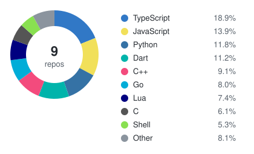

<p align="center"></p>

```
      ___
     /   \
    | ⚡ |    grid up · signal clean
     \___/
    ──┴──
```

<h1 align="center">⚡ Fábio Matos</h1>
<p align="center"><em>Renewable Energy &amp; Power Systems Engineer · OT Security 🛡️ · Applied AI Systems 🤖</em></p>

---

### 🔧 Focus

Renewable energy and power systems engineer working on MV/LV grids and the OT networks that run them — with a growing focus on industrial cybersecurity (IEC 61850, NIS2) and offensive security.

Outside work, I build small AI-driven tools and automation for personal and open-source projects, bridging engineering rigor with modern AI tooling.

### 🧩 Skills

| Domain | Stack |
|---|---|
| ⚡ Power Systems | MV/LV networks, renewable generation |
| 🛡️ OT / ICS Security | IEC 61850 (GOOSE), NIS2 alignment, network segmentation |
| 🌐 Networking | Cisco CCNA · routing, switching, VLANs |
| 🎯 Offensive Security | pentesting, network hardening |
| 🤖 AI & Automation | agentic tooling, local-first AI, TypeScript |
| 🎓 Training | certified trainer (CCP) |

### 🌱 Currently exploring

Decentralized renewable energy · GOOSE traffic monitoring · local-first AI systems

### 🗂️ Repos & languages

<!-- REPOS:START -->
<p align="center"></p>

| Repo | About | Main |
|---|---|---|
| 🍴 [jev-router](https://github.com/Matos182/jev-router) | Pass-through model router for Claude Code and Codex CLI that picks a mo… | JavaScript |
| 📦 [goose-watch](https://github.com/Matos182/goose-watch) | Passive IEC 61850 GOOSE monitor: deterministic rules decide, a local AI… | TypeScript |
| 🍴 [fabric](https://github.com/Matos182/fabric) | fabric is an open-source framework for augmenting humans using AI. It p… | Go |
| 📦 [scythe-companion](https://github.com/Matos182/scythe-companion) | An evolution of the Scythe Coin Calculator, a simple Android App that a… | Dart |
| 🍴 [core](https://github.com/Matos182/core) | :house_with_garden: Open source home automation that puts local control… | Python |
| 🍴 [xmrig](https://github.com/Matos182/xmrig) | RandomX, KawPow, CryptoNight and GhostRider unified CPU/GPU miner and R… | C |
| 📦 [omarchy-chatra-theme](https://github.com/Matos182/omarchy-chatra-theme) | Omarchy extra theme — Lao saa-paper parasols. Hub black, wine silk, ind… | Lua |
| 🍴 [LifeOS](https://github.com/Matos182/LifeOS) | ⛰️ LifeOS — The universal AI Harness designed to move you from Current… | TypeScript |
| 📦 [scythe-coin-calculator](https://github.com/Matos182/scythe-coin-calculator) | A simple Android App that assists players of the popular board game Scy… | Dart |
<!-- REPOS:END -->

<!--
📫 fmlmatos@gmail.com
-->
